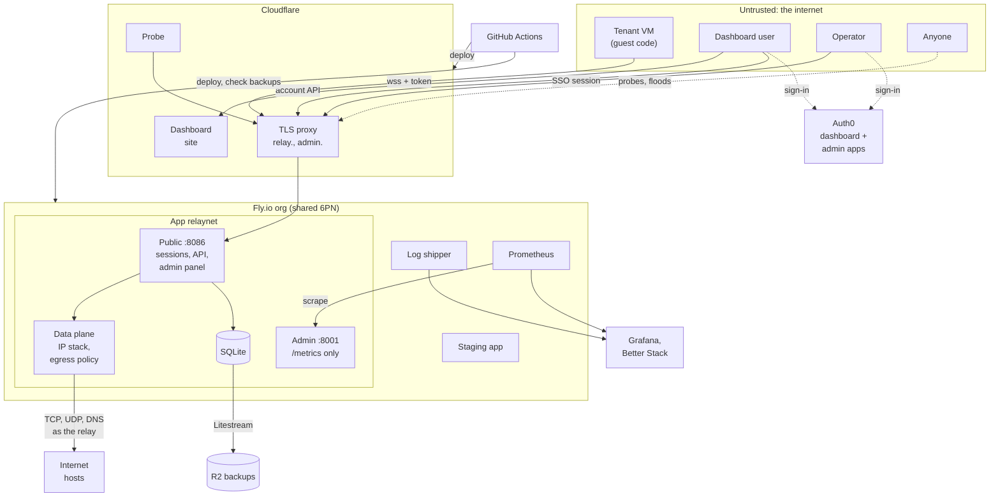

# Threat model

What relaynet protects, who it protects it from, where the trust boundaries
are, and which control answers each threat. Written 2026-10-23 against
production as deployed (rootlessRelay fork `v0.7.0-hosted.12`, Fly release
v33), after the [2026-10-21 audit](audit-2026-10-21.md). Finding IDs (DP-1,
AU-5, …) refer to that report; all of them are fixed or mitigated except where
the table says otherwise.

Review this document when a trust boundary changes: a new component or
third-party service, a new credential, a new way in (transport, API, sign-in
method), multi-region, billing, or the open-source release (#77).

## System

relaynet gives virtual machines that run in a browser (or anywhere else that
can open a WebSocket) a network: the VM's Ethernet frames go over a WebSocket
to the relay, which runs a user-space IP stack and makes the VM's TCP, UDP and
DNS connections to the internet on its behalf. Accounts, organizations, API
tokens and usage live in the relay's SQLite database; people sign in through
Auth0.

## Assets

| Asset | Why it matters |
|---|---|
| Tenant isolation on the shared data plane | Every tenant's VM shares one relay, one address pool and one egress IP. Seeing, spoofing or reaching another tenant's traffic is the worst outcome. |
| The relay's egress position | The relay sits inside Fly's network, next to the admin port, Litestream, Fly's metadata and the 6PN. An open egress path is SSRF into all of that. |
| The egress IP's reputation | One shared address; abuse from one tenant gets it blocked for all. |
| Account data | Email addresses, org membership, invitations, usage, the 30-day connection audit log. Covered by the privacy policy (`infra/legal/privacy.md`). |
| Credentials | Relay API tokens (stored as SHA-256 hashes), Auth0 access and refresh tokens in the browser, the operator's SSO session, deploy and API tokens in GitHub and Fly secrets, R2 keys. |
| Operator control | The panel can create users, change tiers, ban, and read every org. |
| Availability | One relay machine serves every tenant. |
| Metering integrity | Usage drives quotas now and billing later. |

## Actors

| Actor | Capability assumed |
|---|---|
| **Tenant** (signed-in user, any tier) | Runs arbitrary code in their VM, so can send any Ethernet frame, IP packet, DHCP or ARP message. Holds valid tokens. May open the maximum number of sessions. |
| **Other org member** | Valid role in a shared org; may try to exceed it. |
| **Anonymous internet** | Reaches every public endpoint; can create an Auth0 identity only through Google (database sign-up is off, AT-1). Can send invitation links to people. |
| **Hostile web page** | Runs in the same browser as a signed-in user or operator: CSRF, DNS rebinding, framing. |
| **Neighbour on Fly's private network** | Code running in another app of the same Fly org (staging, the log shipper image). |
| **Compromised dependency or action** | Code in an npm package, base image or GitHub Action that runs at build or deploy time. |
| **Third-party provider** | Auth0, Cloudflare, Fly, GitHub, npm, Grafana Cloud, Better Stack. Trusted to do their job; their compromise is out of scope except where noted. |
| **Operator** | Trusted, but their account is a target; actions are attributable. |

## Trust boundaries

### TB1: VM ↔ relay data plane

The relay treats every frame from a VM as hostile.

| Threat | Control | Evidence |
|---|---|---|
| Spoof another tenant's IP or MAC | A session keeps the Ethernet MAC it first used and cannot borrow one bound to another live session; the IP must be the one the session was assigned (`claimIP`: live holder, same owner, address holds) | audit "controls held"; DP-2 |
| Exhaust or steal pool addresses via DHCP | DHCP accepted only for the session's own MAC; one address per session; released on close | DP-1, DP-2 (hosted.4) |
| Reach another tenant's VM | VM-to-VM, ARP and broadcast only between sessions of the same owner (`canReach`) | audit; DP-2 |
| Stale traffic reaching a reused address | Addresses held for the owner across a reconnect; stale TCP segments reset; inbound rules refused in hosted mode | AD-4 (hosted.12) |
| SSRF to the relay host, Fly metadata, 6PN, admin or Litestream ports | Hosted egress deny-list (RFC 1918, link-local, CGNAT, loopback, multicast, documentation ranges) plus the host's own addresses; no IPv6 or DNS-rebinding bypass found | audit "controls held" |
| Abuse from the shared egress IP | Port 25 denied; UDP reflector ports denied; per-tier SYN, DNS and bandwidth limits; SYN and DNS rates shared by an owner's sessions | DP-3 (hosted.6), DP-4 (hosted.12) |
| Resource exhaustion (connections, flows, memory) | Per-tier caps on TCP connections and UDP flows; sessions per account and per address; session lifetime and idle timeout; bounded peer queues | tiers table, `policy/tiers.js` |
| Free traffic past the quota | Quota checked at admission and at each 30-second flush; over-quota sessions closed | MT-4 (accepted: overrun ≤ ~1.2 %) |

### TB2: Clients ↔ public listener (sessions and account API)

| Threat | Control | Evidence |
|---|---|---|
| Session without a valid credential | Every session needs an API token or an Auth0 access token; anonymous tier off | `ANON_ENABLED=false` |
| Forged or misdirected JWT | RS256 via the tenant's JWKS; `iss` and `aud` checked; only two Auth0 clients exist | AT-2 (Default App deleted) |
| Stolen API token | Stored as SHA-256 hashes, compared in constant time; revocable from the dashboard, which ends live sessions | audit "controls held" |
| Token that outlives its purpose | A live session keeps the identity it opened with; revocation ends it, expiry does not | AU-8 (by design) |
| Account under an unverified address | No account is created for a sign-in whose email is not verified | AU-5 (hosted.11) |
| Pending account acting before activation | Every mutating route requires an active account except redeem and delete | AU-1 (hosted.4) |
| Operator privilege through an API token | Operator privilege only for a signed-in JWT, never an API token | AU-2 (hosted.4) |
| Role escalation inside an org | Role rules enforced in the store; invitations single-use, atomic, bound to a verified address | audit "controls held" |
| Cross-site calls from another origin | CORS limited to `ALLOWED_ORIGINS`; bearer tokens, no cookies on the account API | `relay/fly.toml` |
| Client-IP spoofing to dodge per-address limits | `CF-Connecting-IP` trusted only from Cloudflare's published ranges | CI-14 (static list; drift fails safe) |
| Error text leaking internals | Non-object bodies refused; generic body for 5xx | AU-4 (hosted.7) |
| Log injection | JSON logs; strings capped at 256 characters | MT-6 (hosted.9) |

### TB3: Browser ↔ dashboard (relaynet.network)

| Threat | Control | Evidence |
|---|---|---|
| XSS turning into relay access | API data inserted only as text nodes; CSP `script-src 'self'` with the Auth0 SDK served from the site; `frame-ancestors 'none'` | WB-5 (#137), WB-6 |
| Token theft after an XSS or a bad extension | Refresh tokens rotate with reuse detection, 7 days absolute and 1 day idle; relay access tokens are short-lived | WB-1 (mitigated; cache stays in `localStorage`) |
| Invitation token leaking through logs or history | Token in the URL fragment, removed from the address bar at once, kept only in this tab's session storage | WB-3 (#130) |
| Being joined to an org by someone else's link | Join or Ignore step before accepting | WB-4 (#140) |
| Plaintext WebSocket or token echo in the client library | `ws://` refused except to loopback; token redacted from errors | WB-7 (client 0.1.2) |

### TB4: Operator ↔ admin panel (admin.relaynet.network)

| Threat | Control | Evidence |
|---|---|---|
| An ordinary Auth0 user signing in as operator | OIDC identity must map to an existing active `operator` row; the token must carry `amr: mfa`; audience is the admin client; MFA enforced with no remember-browser skip | audit "controls held" |
| Password guessing | Password login off in production; constant-work check where it is on | AD-1 (hosted.9) |
| CSRF or DNS rebinding from a hostile page | Writes need `X-Requested-With: relaynet-admin` and a same-origin `Origin`; Host allowlist (421 otherwise); `SameSite` session cookie, `Secure` | AD-2 (hosted.10) |
| Clickjacking or script injection in the panel | CSP with the one inline script pinned by hash; `X-Frame-Options: DENY`; `nosniff`; no `X-Powered-By` | AD-7 (hosted.10) |
| Relay sessions on the admin hostname | Upgrades on `admin.relaynet.network` refused | AD-8 (hosted.10) |
| Operator session after demotion | Role and status re-read on every request | AD-5 (Info: no per-operator session kill) |

### TB5: Fly private network (6PN)

Every app in the Fly org can reach every other app's private addresses.

| Threat | Control | Evidence |
|---|---|---|
| A neighbour app driving the production panel | Port 8001 answers only `/metrics`; the panel is served only on the public hostname with SSO | CI-7 (hosted.12) |
| A neighbour reading metrics | Accepted: metrics carry counts and labels, no identities; Fly's scraper cannot authenticate | CI-7 (residual) |
| Compromised log-shipper image | Image pinned by digest; read-only org token used only for the log stream | CI-6 |
| Staging as a stepping stone | Staging has its own database, backups and secrets; its panel is private (`fly proxy`) with password login | CI-7 (residual: shares the 6PN) |

### TB6: Relay ↔ storage and backups

| Threat | Control | Evidence |
|---|---|---|
| Data loss | Litestream to R2 continuously; Fly volume snapshots as an independent copy; weekly restore check in CI | `backup-restore-check.yml` |
| A relay compromise deleting its own backups | Volume snapshots are outside the relay's reach | CI-11 (accepted: the relay's R2 key is read-write) |
| Backup contents exposed | R2 bucket private; CI uses a read-only key, prints counts only, uploads no artifacts, on ephemeral runners | CI-10 |
| Retention drift | Audit rows purged after 30 days; usage rows for deleted orgs not re-created | MT-3 (hosted.7), MT-9 (Info) |

### TB7: Build and deploy (GitHub, npm, registries)

| Threat | Control | Evidence |
|---|---|---|
| A compromised action or a moved tag | Every action pinned by full SHA; flyctl version pinned; Dependabot for npm, Docker and Actions; vulnerability alerts on | CI-2, CI-3 |
| Install-time code from a dependency | `npm ci --ignore-scripts`, then only `sqlite3` rebuilt | CI-5 |
| A changed base image | Base and log-shipper images pinned by digest | CI-6 |
| A changed relay dependency | The fork is pinned to a release tag whose version must match `package.json`; the lockfile hash fails closed on any change | CI-9 (residual: GitHub archive, #25) |
| Deploying unreviewed code to production | `production`, `cloudflare` and `npm` environments accept only `main`; production deploys are a manual promotion | CI-1 (residual: no required reviewer until the repo is public, #77) |
| Leaked deploy credentials | Fly deploy tokens scoped to one app; Cloudflare token limited to Workers on one zone, with an expiry; npm publishes by OIDC trusted publishing with no stored token; secrets live in environments | #132 |
| Secrets in the repository | Full-history scan clean; run gitleaks again before publication | audit "Open-source readiness", #79 |

### TB8: relaynet ↔ third-party services

| Dependency | What it could do if compromised | What limits it |
|---|---|---|
| Auth0 | Mint tokens for any user, including an operator identity | Operator also needs an existing `operator` row and MFA; relay refuses unverified addresses. Accepted dependency. |
| Cloudflare | See and alter all HTTP and WebSocket traffic; serve a different dashboard | TLS to Fly is Full (strict). Accepted dependency. |
| Fly.io | Full control of the relay and its volume | Accepted dependency. |
| GitHub | Change code and run deploys | Accepted dependency. The owner account should have 2FA or a passkey (CI-1); not verified here. |
| Grafana Cloud, Better Stack | Read logs (which include emails and client IPs) and metrics | Read-only tokens; logs as described in the privacy policy (MT-7). |

## Accepted risks

- **Tokens in `localStorage`** (WB-1): accepted with short refresh-token
  lifetimes and rotation.
- **Identity frozen at session upgrade** (AU-8): revocation ends a session;
  token expiry does not.
- **Quota overrun window** (MT-4): up to one flush interval, recorded.
- **Unauthenticated `/metrics` on the private network** (CI-7): Fly's scraper
  has no way to authenticate.
- **Read-write R2 key on the relay** (CI-11): volume snapshots are the
  independent copy.
- **Auth0 short log retention** (AT-4): no log stream, so the forensic
  window for sign-in events is days.

## Open items

- **No required reviewer on production deploys** (CI-1). Waits for the
  public repository and its plan (#77).
- **Relay dependency is a GitHub archive; no SBOM** (CI-9, #25).
- **Fork repository default workflow permissions are `write`** (CI-12).
  `relaynet` is `read`.
- **External review**: no penetration test or responsible-disclosure policy
  yet (#26, #80).

## Not yet assessed

From the audit's scope notes, still open:

- Cloudflare zone settings (HSTS, R2 token scopes, log retention).
- Grafana Cloud retention.
- Fuzzing of the relay's TCP state machine.
- Single-machine availability against a determined flood beyond Cloudflare's
  edge protection and the per-tier limits.
